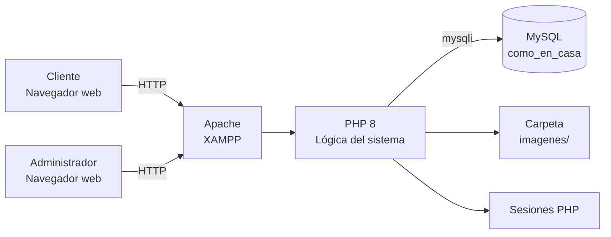
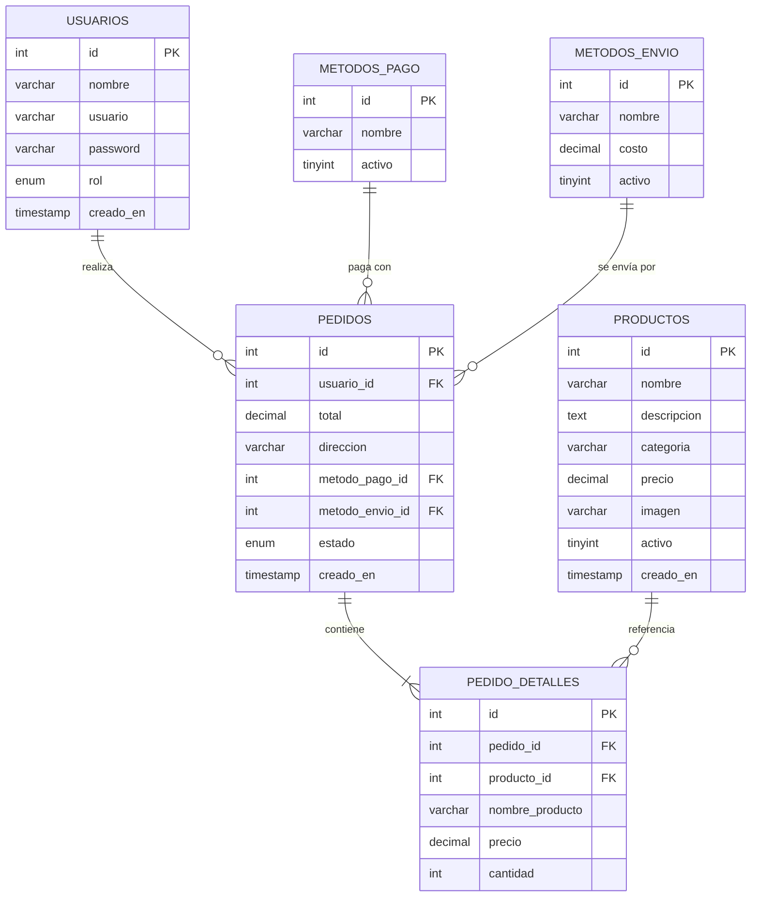
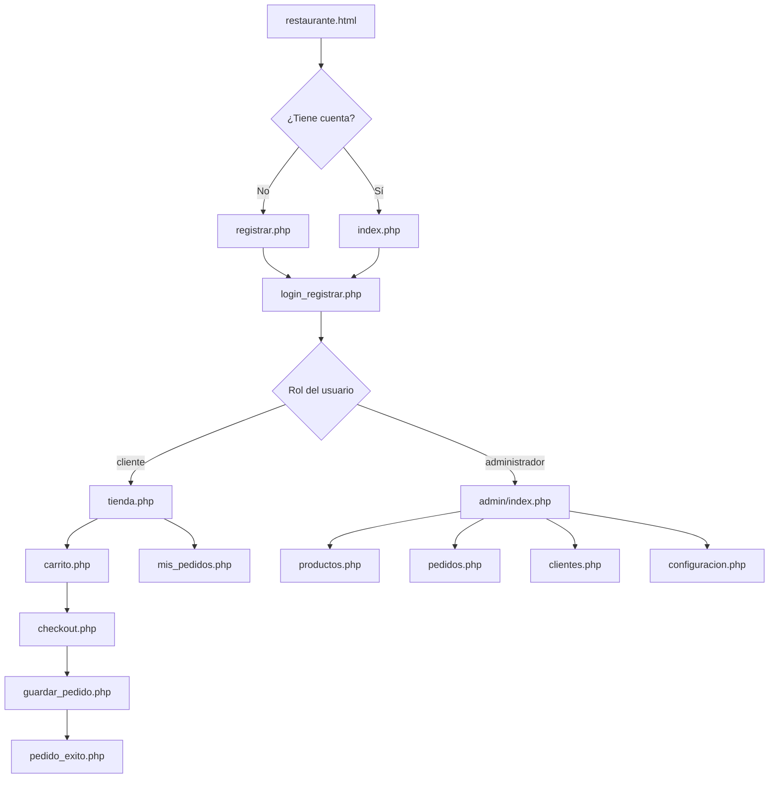
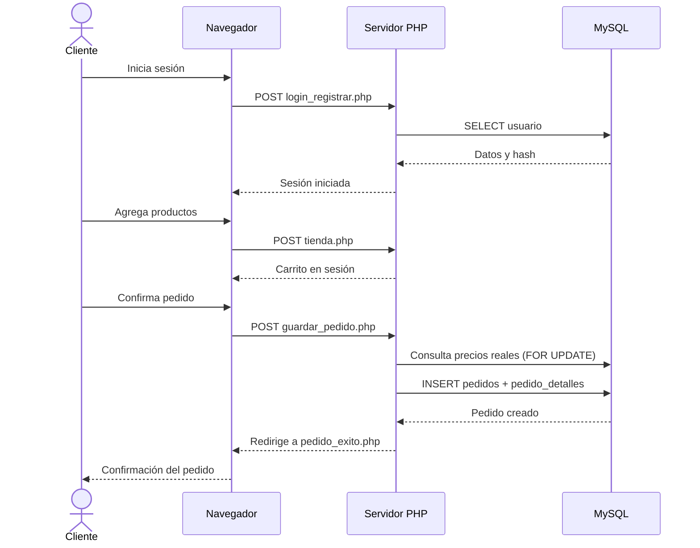
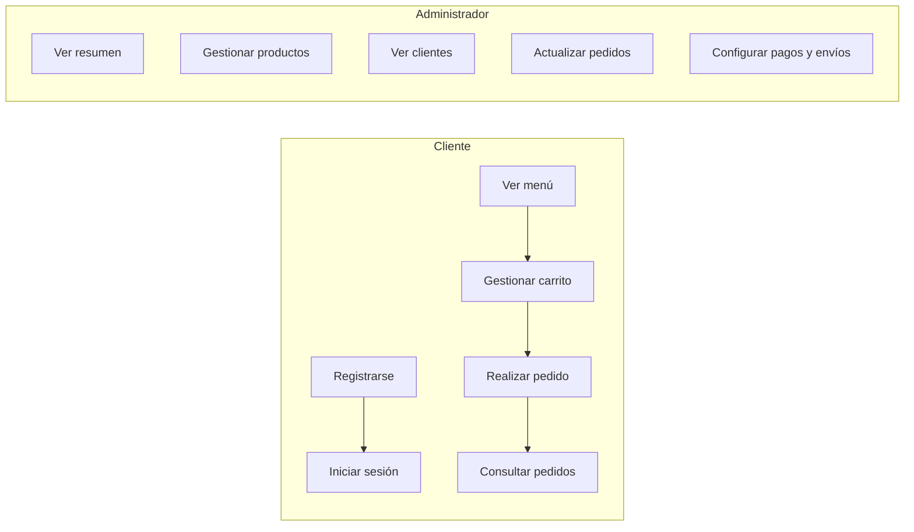

# Restaurante "Como en Casa"

Sistema web de gestión de pedidos para el restaurante **Como en Casa**, desarrollado como proyecto académico de **Programación Orientada a Objetos (POO)** del **IEST Paiján**.

El sistema permite a los clientes registrarse, iniciar sesión, consultar el menú, armar un carrito y registrar pedidos con delivery o recojo en local. El administrador cuenta con un panel para gestionar productos, clientes, pedidos y métodos de pago/envío.

---

## Sitio web en línea (GitHub Pages)

- **Página principal:** https://e2025102-source.github.io/Restaurante_Como_en_Casa/
- **Carta completa:** https://e2025102-source.github.io/Restaurante_Como_en_Casa/carta.html

> GitHub Pages solo publica archivos estáticos (HTML, CSS, JavaScript). El sistema PHP completo se ejecuta localmente con XAMPP (ver la sección *Instalación local* más abajo).

---

## Tecnologías utilizadas

| Capa | Tecnología |
|------|------------|
| Frontend | HTML5, CSS3, JavaScript |
| Backend | PHP 8 (procedural + POO con `mysqli`) |
| Base de datos | MySQL / MariaDB |
| Servidor local | Apache (XAMPP) |
| Seguridad | `password_hash` / `password_verify`, sesiones PHP, consultas preparadas |

---

## Funcionalidades

### Cliente
- Registro público de cuentas (rol `cliente` asignado automáticamente en el servidor).
- Inicio y cierre de sesión seguro.
- Visualización del menú por categorías con imágenes y precios.
- Carrito de compras con cantidades (máximo 20 por producto).
- Checkout con dirección, método de envío y método de pago.
- Consulta del historial y estado de sus pedidos.

### Administrador
- Panel de resumen: clientes, productos, pedidos pendientes y ventas.
- CRUD de productos (crear, editar, eliminar, activar/ocultar).
- Listado de clientes registrados con cantidad de pedidos.
- Gestión del estado de los pedidos (Pendiente, En preparación, En camino, Entregado, Cancelado).
- Configuración de métodos de pago y métodos de envío (con costo).

### Seguridad implementada
- Contraseñas cifradas con `password_hash`.
- Consultas preparadas para evitar inyección SQL.
- Validación del rol en cada sección (`exigir_login` / `exigir_admin`).
- Los precios se recalculan desde la base de datos al confirmar el pedido (no se confía en el navegador).
- Instalador `crear_admin.php` que se bloquea cuando ya existe un administrador.
- Transacciones (`begin_transaction` / `commit` / `rollback`) al guardar pedidos.

---

## Estructura del repositorio

```
Restaurante_Como_en_Casa/
├── README.md
├── docs/                        # Sitio estático publicado en GitHub Pages
│   ├── index.html               # Portada del restaurante
│   ├── carta.html               # Carta completa (entradas, platos, bebidas, postres)
│   ├── imagenes/                # Imágenes de la portada
│   └── favicon.svg
├── sistema_gestion/             # Sistema de gestión PHP + MySQL + app Android
│   ├── index.php                # Login del panel de gestión
│   ├── menu.php                 # Carta pública (requiere PHP)
│   ├── api.php                  # API interna
│   ├── assets/                  # CSS, JS e imágenes
│   ├── app/                     # Clases PHP (Auth, Database, modelos)
│   ├── config/config.php        # Configuración de la base de datos
│   ├── database/                # Esquema, datos de demostración y módulo de menú del día
│   └── android/                 # Aplicación Android de registros y reportes
├── sistema_completo/            # Sistema PHP + MySQL completo (versión anterior)
│   ├── index.php                # Login
│   ├── registrar.php            # Registro de clientes
│   ├── login_registrar.php      # Lógica de autenticación
│   ├── restaurante.html         # Página principal / menú visual
│   ├── tienda.php               # Catálogo de productos
│   ├── carrito.php              # Carrito de compras
│   ├── checkout.php             # Datos de envío y pago
│   ├── guardar_pedido.php       # Registro del pedido en MySQL
│   ├── mis_pedidos.php          # Historial del cliente
│   ├── crear_admin.php          # Instalador del administrador
│   ├── conexion.php             # Conexión a MySQL
│   ├── funciones.php            # Utilidades y control de sesión
│   ├── estilos.css              # Estilos del sistema
│   ├── base_datos.sql           # Script de creación de la base de datos
│   ├── imagenes/                # Imágenes de platos y sliders
│   └── admin/                   # Panel de administración
│       ├── index.php            # Resumen general
│       ├── productos.php        # CRUD de productos
│       ├── clientes.php         # Listado de clientes
│       ├── pedidos.php          # Gestión de pedidos
│       ├── configuracion.php    # Métodos de pago y envío
│       └── menu.php             # Menú del panel
├── web_restaurante/             # Versión web original (HTML/CSS/PHP + imágenes)
└── documentos/                  # Informes y documentación del proyecto
    ├── Proyecto_POO_COMO_EN_CASA_ARQUITECTURA_Y_MOVIL.docx
    ├── Proyecto_POO_Sistema_Gestion_Restaurante_COMPLETO.docx
    ├── INFORME_FINAL_POO.docx
    └── Interfaz_Grafica.html
```

---

## Diagramas

### 1. Arquitectura del sistema



### 2. Modelo entidad-relación



### 3. Flujo de navegación del usuario



### 4. Secuencia de compra



### 5. Casos de uso



---

## Instalación local (XAMPP)

1. Copia la carpeta `sistema_completo` dentro de `C:\xampp\htdocs\` y renómbrala a `como_en_casa_sistema`.
2. Abre el Panel de Control de XAMPP y enciende **Apache** y **MySQL**.
3. Ingresa a `http://localhost/phpmyadmin`.
4. Importa el archivo `base_datos.sql` (pestaña **Importar**) o ejecuta su contenido en la pestaña **SQL**.
5. Verifica `conexion.php`. Valores por defecto:

   | Parámetro | Valor |
   |-----------|-------|
   | Servidor | `localhost` |
   | Usuario MySQL | `root` |
   | Contraseña MySQL | *(vacía)* |
   | Base de datos | `como_en_casa` |

6. Abre una sola vez `http://localhost/como_en_casa_sistema/crear_admin.php` y crea tu usuario administrador.
7. Ingresa por `http://localhost/como_en_casa_sistema/index.php`.
8. Página principal: `http://localhost/como_en_casa_sistema/restaurante.html`.

> Importante: no abras los archivos `.php` con doble clic; siempre mediante `http://localhost/...`.

---

## Base de datos

Tablas creadas por `base_datos.sql`:

- `usuarios`: cuentas de clientes y administradores.
- `productos`: platos disponibles con precio, categoría e imagen.
- `metodos_pago`: efectivo, transferencia, Yape/Plin, etc.
- `metodos_envio`: delivery y recojo en local (con costo).
- `pedidos`: cabecera del pedido (cliente, total, dirección, estado).
- `pedido_detalles`: productos, cantidades y precios históricos del pedido.

---

## Notas de seguridad

- Este proyecto está pensado para ejecutarse en un entorno local académico.
- Para publicarlo en Internet se recomienda: HTTPS, usuario MySQL con permisos limitados, protección CSRF, validación adicional del lado del servidor y eliminar `crear_admin.php` después de la configuración inicial.
- Nunca subas contraseñas reales ni tokens al repositorio.

---

## Documentación

Los informes completos del proyecto se encuentran en la carpeta [`documentos/`](documentos/), incluyendo la arquitectura, el modelado y la interfaz gráfica.
